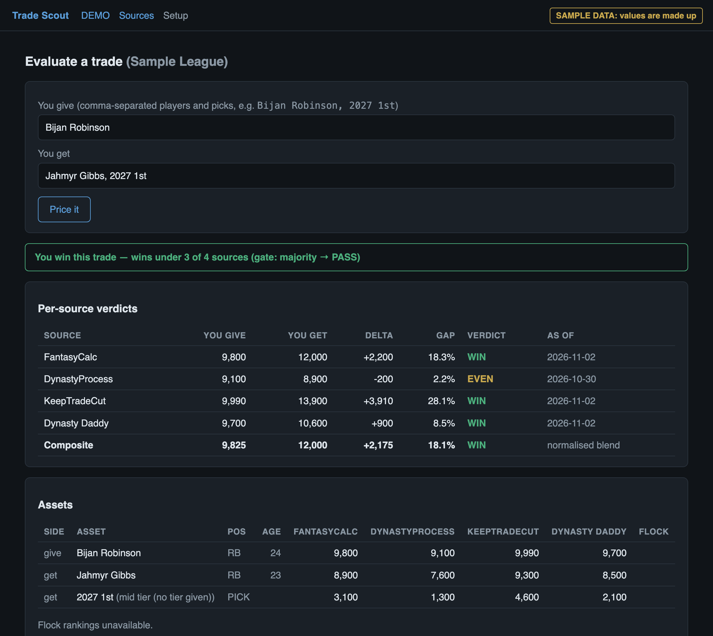
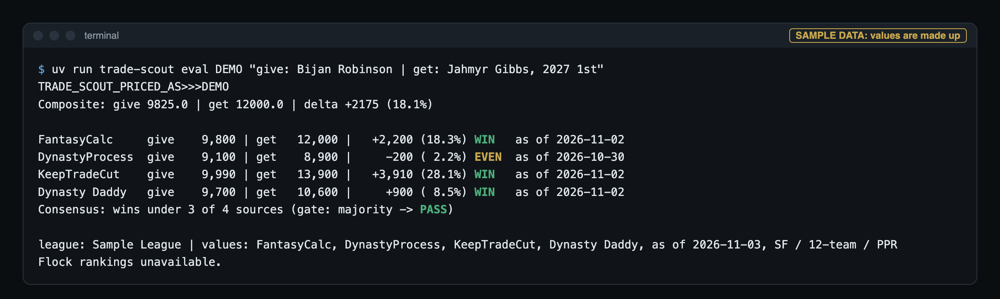

<div align="center">

# Trade Scout

**Price a dynasty fantasy football trade against four value sources at once, and see where they disagree.**

A local trade evaluator for [Sleeper](https://sleeper.com) leagues. One
calculator's opinion is a data point. Four of them disagreeing is the real answer.

`uv run trade-scout serve` for the web UI · `uv run trade-scout eval` from the terminal

<sub>MIT licensed · Python 3.12+ · no accounts, no server, no database</sub>

</div>

<br>

<div align="center">
  
  <br>
  <sub>The trade page. Sample data: every value in this image is made up.</sub>
</div>

<br>

---

## Why

Every dynasty trade calculator gives you one confident number. They are built
on different data, so they often disagree, and a single number hides that.

Trade Scout prices the whole trade under each source separately, shows every
row with its as-of date, and only then turns the rows into one verdict. If a
source is down or stale, it is left out *and the verdict says so*. If a player
can't be matched, he is named, never quietly priced at zero.

It also has optional AI help, with one hard rule: **the engine owns the
numbers.** Anything an LLM proposes is re-priced by code before you see it.

| Source | Basis | Access |
|:--|:--|:--|
| [FantasyCalc](https://fantasycalc.com) | real completed dynasty trades | open API |
| [DynastyProcess](https://dynastyprocess.com) | FantasyPros expert consensus | open weekly CSVs |
| [KeepTradeCut](https://keeptradecut.com) | crowdsourced rankings | page scrape |
| [Dynasty Daddy](https://dynasty-daddy.com) | their in-house model | unofficial API |

Draft picks are priced from each source's own pick sheet.

## Install

Requires Python 3.12+ and [uv](https://docs.astral.sh/uv/).

```sh
git clone https://github.com/Bjepp77/trade-scout.git
cd trade-scout
uv sync
uv run trade-scout setup
```

`setup` asks for your Sleeper username, lists your leagues by number, and asks
for a short name for each league you pick. It saves them to
`~/.trade-scout/config.json`, outside the repo.

| Optional extra | Adds |
|:--|:--|
| `uv sync --extra dev` | pytest, ruff and pyright for development. |
| `uv sync --extra flock` | Flock Fantasy as a side-by-side second opinion. See below. |

## Usage

```sh
uv run trade-scout serve       # web UI at http://127.0.0.1:8177
uv run trade-scout eval DEMO "give: Bijan Robinson | get: Jahmyr Gibbs, 2027 1st"
uv run trade-scout rosters     # every roster in the league, priced, as JSON
```

<div align="center">
  
  <br>
  <sub>The same trade from the terminal. Sample data: every value is made up.</sub>
</div>

<br>

`DEMO` stands for whatever short name you gave your league in `setup`. There is
no default league: `eval` refuses to run without a short name it knows.

**Trade grammar.** `give: A, B | get: C, 2027 1st`. A leading `/trade` and a
leading league short name are both accepted. Picks can be written as
`2027 1st`, `2027 Early 1st`, `2027 1st (Early)` or `2026 1.03`. A future pick
with no tier is priced at mid tier, and the result says so, for example
`(mid tier (no tier given))`.

**Trade ideas.** Start the text with `consult`, or write something like
"he wants my ..." or "trades I could do with ...". Candidate packages are built
from the partner's roster, each one is re-priced against every source, and only
priceable, non-losing options come back, labelled BEST DEAL, FAIR DEAL or
STRETCH by their measured deltas.

**Web UI.** `serve` gives you the trade page, a roster board, a sources page
(which calculators are live, how fresh they are, what failed) and a setup page.
Use `--port` and `--host` to change where it listens.

**Terminal output.** `eval` always prints `TRADE_SCOUT_PRICED_AS>>><SHORT>` as
its first stdout line, so a script can tell which league was priced. Log lines
go to stderr.

**AI assist (optional).** If the [Claude Code CLI](https://claude.com/claude-code)
(`claude`) is installed and signed in, you also get plain-English trade input,
AI-drafted trade ideas and a prose verdict. Set `TRADE_SCOUT_LLM=off` to turn
it off. Without it, the structured grammar, a deterministic idea enumerator and
a numeric `Composite:` summary stand in.

**Flock Fantasy (optional).** If you have a Flock account, its rankings and
trade calculator sit beside the verdict as a second opinion. Flock never votes
and is never blended in. It logs in as you through a headless browser. Copy
`.env.example` to `.env`, fill in the Flock fields, then run
`uv sync --extra flock && uv run playwright install chromium`. Flock
credentials are read only from the environment or `.env` (gitignored), never
from the config file.

## How the verdict works

1. **One row per source, on its own scale.** Sources publish on very different
   scales. At the median, KeepTradeCut's number is about 2.3x FantasyCalc's for
   the same player, so no row mixes sources.
2. **Each row casts a vote.** A row is WIN, LOSS or EVEN. A gap inside the even
   band (3% by default) is EVEN, so a 0.2% edge does not count as a win.
3. **The gate decides.** `all`, `any`, or `majority` (the default: more than
   half of the sources that can vote).
4. **Stale sources sit out.** A source older than its limit (DynastyProcess
   10 days, Dynasty Daddy 3 days) is shown but does not vote, by default.
5. **Nothing is hidden.** Players or picks that could not be priced are named
   ("couldn't price: ..."), and failed sources are listed as
   "unavailable: <reason>".

The **composite** maps every source onto one reference curve by rank, then
blends them. It is for sorting only and never decides the verdict.

Gate, even band and stale handling live under `consensus` in
`~/.trade-scout/config.json` (`gate`, `even_band_pct`, `exclude_stale`). The
full architecture is in [docs/DESIGN.md](docs/DESIGN.md).

## Privacy

Trade Scout runs on your machine. There is no account and no server of ours.
It calls only these hosts:

| Host | Why |
|:--|:--|
| `api.sleeper.app` | your leagues, rosters, picks and the player map |
| `api.fantasycalc.com` | FantasyCalc values |
| `keeptradecut.com` | KeepTradeCut values |
| `raw.githubusercontent.com/dynastyprocess` | DynastyProcess CSVs |
| `dynasty-daddy.com` | Dynasty Daddy values |
| `flockfantasy.com` | only if you set Flock credentials |

If AI assist is on, your trade text goes through the `claude` CLI under your
own Claude account.

Local files, all outside the repo:

| Path | Holds | Override |
|:--|:--|:--|
| `~/.trade-scout/config.json` | your Sleeper username and leagues | `TRADE_SCOUT_CONFIG` |
| `~/.trade-scout/cache/` | fetched values | `TRADE_SCOUT_CACHE_DIR` (empty disables) |
| `~/.trade-scout/history/` | daily value snapshots from the roster board | `TRADE_SCOUT_HISTORY_DIR` (empty disables) |

Values are cached so sources are hit rarely: FantasyCalc and KeepTradeCut
30 minutes, Dynasty Daddy 6 hours, DynastyProcess 24 hours, the Sleeper player
map 20 hours, Flock rankings 6 hours.

## Security note

The web UI has **no login, by design**. Anyone who can reach the port can use
it and see your league data. It listens on `127.0.0.1` by default. Keep it
there. Do not pass `--host 0.0.0.0`, and do not expose the port to a network,
a tunnel or the internet.

## When something breaks

| Symptom | Fix |
|:--|:--|
| `eval` refuses to run | Give it a league short name from `setup`, or run `setup` again. |
| A source shows "unavailable" | That source failed or changed. The verdict runs on the rest. KeepTradeCut is a page scrape and Dynasty Daddy is an unofficial API, so either can break without notice. |
| A source is shown but does not vote | It is stale. Check its as-of date on the sources page. |
| "couldn't price: ..." | The name did not match a player. Check the spelling. |
| Wrong league id | Set `SLEEPER_LEAGUE_<SHORT>` to override the id for that short name. |
| Odd or old values | Clear `~/.trade-scout/cache/`, or set `TRADE_SCOUT_CACHE_DIR=` to skip the cache. |
| No AI features | Install and sign in to the `claude` CLI, and check `TRADE_SCOUT_LLM` is not `off`. |

## Development

```sh
uv sync --extra dev
uv run pytest -q
uv run ruff check
uv run pyright
```

The test suite is hermetic. An autouse guard makes every provider fetch and raw
HTTP call raise, and masks your real `.env`, config and `claude` CLI. CI on
GitHub Actions runs lint, type checks and tests on every push and pull request
([.github/workflows/ci.yml](.github/workflows/ci.yml)).

Built with FastAPI, Jinja2 and vendored htmx for the web UI, httpx for
fetching, rapidfuzz for name matching, and optional Playwright for Flock.

## Requirements

- Python 3.12+ and [uv](https://docs.astral.sh/uv/)
- A [Sleeper](https://sleeper.com) account with at least one dynasty league
- Optional: the `claude` CLI for AI assist, a Flock Fantasy account for Flock

Sleeper is the only league platform supported. Version 0.2.0. Built for
personal use. Not affiliated with Sleeper, FantasyCalc, DynastyProcess,
KeepTradeCut, Dynasty Daddy or Flock.

## License

[MIT](LICENSE).
