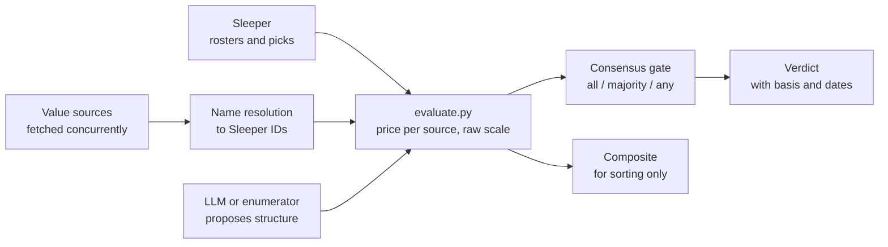

<div align="center">

# Trade Scout

**Price a dynasty fantasy football trade against four value sources at once, and see where they disagree.**

A local trade evaluator for [Sleeper](https://sleeper.com) leagues. One
calculator's opinion is a data point. Four of them disagreeing is the real answer.

`uv run trade-scout serve` for the web UI · `uv run trade-scout eval` from the terminal

<sub>MIT licensed · Python 3.12+ · runs on your machine · no accounts, no server, no database</sub>

</div>

<br>

```
FantasyCalc     give   10,071 | get   13,226 |   +3,155 (23.9%) WIN   as of 2026-08-24
DynastyProcess  give    7,995 | get    9,445 |   +1,450 (15.4%) WIN   as of 2026-08-21
KeepTradeCut    give    9,999 | get   15,535 |   +5,536 (35.6%) WIN   as of 2026-08-24
Dynasty Daddy   give    9,998 | get   15,481 |   +5,483 (35.4%) WIN   as of 2026-08-24
Consensus: wins under 4 of 4 sources (gate: majority -> PASS)
```
<div align="center"><sub>An example verdict. Each row is priced on that source's own scale.</sub></div>

<br>

---

## Why

Every dynasty trade calculator gives you one confident number. They are built
on different data, so they often disagree, and a single number hides that.

Trade Scout prices the whole trade under each source separately, shows every
row with its as-of date, and only then turns the rows into one verdict. If a
source is down or stale, it is left out *and the verdict says so*. If a player
can't be matched, he is named, never quietly priced at zero.

It also has optional AI help, with one hard rule: **the engine owns the
numbers.** Anything an LLM proposes is re-priced by code before you see it.

## Value sources

| Source | Basis | Access |
|:--|:--|:--|
| [FantasyCalc](https://fantasycalc.com) | real completed dynasty trades | open API |
| [DynastyProcess](https://dynastyprocess.com) | FantasyPros expert consensus | open weekly CSVs |
| [KeepTradeCut](https://keeptradecut.com) | crowdsourced rankings | page scrape |
| [Dynasty Daddy](https://dynasty-daddy.com) | their in-house model | unofficial API |

Draft picks are priced from each source's own pick sheet.

## Features

- **Trade evaluator.** Enter both sides. Get the per-source verdict table, a
  consensus banner and a per-asset breakdown.
- **Trade ideas.** Name a player you want from a league-mate. Candidate
  packages are built from the partner's roster, every one is re-priced by the
  engine against all sources, and only priceable, non-losing options come
  back, labelled BEST DEAL / FAIR DEAL / STRETCH by their measured deltas.
- **Roster board.** Every roster in the league priced and scored, with
  per-source values kept visible.
- **Sources page.** Which calculators are live, how fresh they are, and what failed.
- **Consensus gate.** `all`, `majority` or `any`, with an even band so a
  0.2% edge does not cast a vote. Default: majority, 3% even band.

## How it works



**Scale discipline.** Sources publish on very different scales. At the
median, KeepTradeCut's number is about 2.3x FantasyCalc's for the same player.
So each verdict row uses one source's raw values only. A composite exists for
sorting: it maps every source onto one reference curve by rank, then blends
with set weights. The rows are the truth; the composite is a convenience.

**The consult loop.** Whatever proposes a trade, an LLM or a plain
enumerator, proposes structure only. Every candidate goes back through the
same `evaluate_trade` code. This is load-bearing: an earlier design let the
LLM write its own value delta, and nothing checked it.

The full architecture is in [docs/DESIGN.md](docs/DESIGN.md).

## Quick start

Requires Python 3.12+ and [uv](https://docs.astral.sh/uv/).

```sh
git clone https://github.com/Bjepp77/trade-scout.git
cd trade-scout
uv sync
uv run trade-scout setup     # your Sleeper username, then pick your leagues
uv run trade-scout serve     # open http://127.0.0.1:8177
```

Or from the terminal:

```sh
uv run trade-scout eval DD "give: Bijan Robinson | get: Jahmyr Gibbs, 2027 1st"
uv run trade-scout rosters   # full priced roster board as JSON
```

`DD` is whatever short name you gave your league during setup. Your league
config is saved to `~/.trade-scout/config.json`, outside the repo.

## Optional extras

**AI assist.** If the [Claude Code CLI](https://claude.com/claude-code)
(`claude`) is installed and signed in, you also get plain-English trade input
("my CMC and a 2027 1st for Bijan"), AI-drafted trade ideas and a prose
verdict. Without it, everything above still works: a structured grammar, a
deterministic idea enumerator and a numeric summary stand in.

**Flock Fantasy.** If you have a Flock account, its rankings and trade
calculator can sit beside the verdict as a second opinion. It is never
blended in and never votes. It uses your own login through a headless
browser. Copy `.env.example` to `.env`, fill in the two Flock fields, then
run `uv sync --extra flock && uv run playwright install chromium`.

## Development

```sh
uv sync --extra dev
uv run pytest -q       # hermetic: the suite never touches the network
uv run ruff check
uv run pyright
```

The test suite is hermetic. An autouse guard makes every provider fetch and
raw HTTP call raise, and masks your real `.env`, config and `claude` CLI. CI
on GitHub Actions runs lint, type checks and tests on every push
(`.github/workflows/ci.yml`).

## Tech stack

Python 3.12, FastAPI, Jinja2 and vendored htmx for the local web UI. httpx
for fetching, rapidfuzz for name matching. Optional Playwright for Flock.
uv for packaging, pytest, ruff and pyright for checks.

## Status and limits

- **v0.2.0**, per `pyproject.toml`.
- KeepTradeCut is a page scrape and Dynasty Daddy is an unofficial API. Either
  can change or disappear. If one does, the tool drops it and says so.
- Values are fetched politely: cached, low frequency, public endpoints.
- Built for personal use. Sleeper is the only league platform supported.

## Disclaimer

Not affiliated with Sleeper, FantasyCalc, DynastyProcess, KeepTradeCut,
Dynasty Daddy or Flock.

## License

[MIT](LICENSE).
